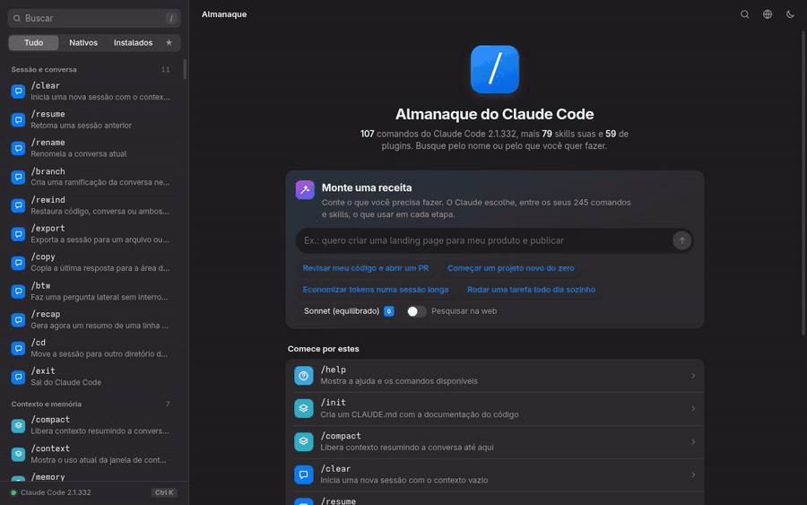
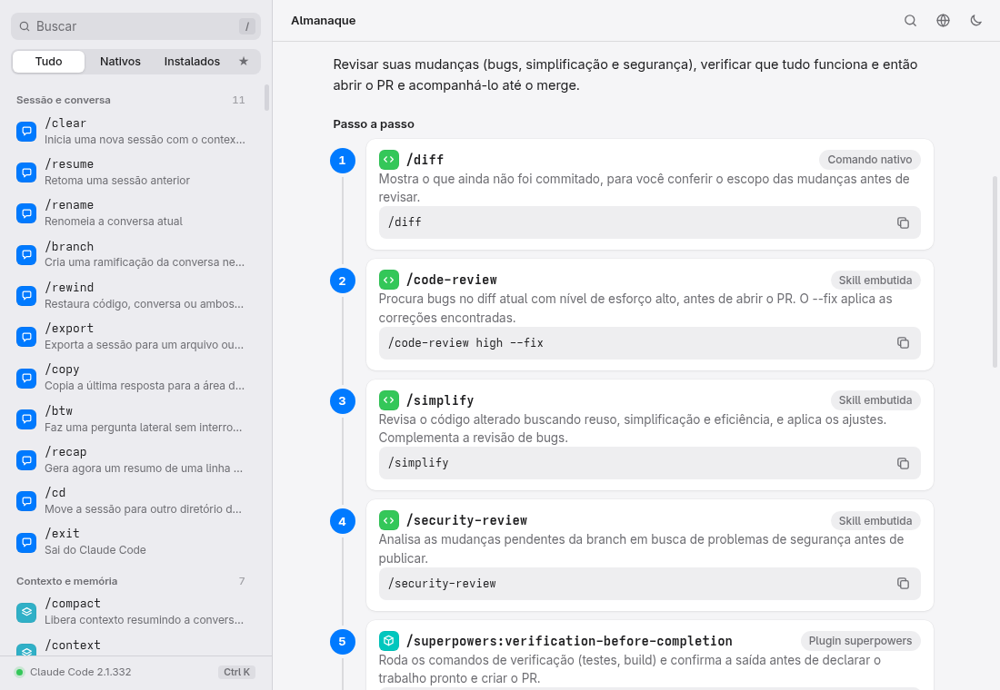

# Almanaque de Claude Code

[](https://www.npmjs.com/package/claude-code-almanac) [](https://github.com/GuilhermeBartmann/claude-code-almanac/actions/workflows/ci.yml) [](LICENSE)

[English](README.md) · [Português](README.pt-BR.md) · **Español**

Una guía con búsqueda de todos los comandos `/` de Claude Code, en español, inglés y portugués. Lee *tu* instalación (comandos nativos, tus skills, tus plugins) y deja que Claude arme una receta paso a paso con lo que realmente tienes.



## Ejecutar

Requiere Node.js 18 o superior. Sin dependencias.

```bash
npx claude-code-almanac
# o
pnpm dlx claude-code-almanac
```

Se abre en su propia ventana, sin pestañas ni barra de direcciones, usando el modo aplicación de Chrome, Chromium, Edge o Brave (el que tengas; Edge viene con Windows). Si no tienes ninguno, se abre en una pestaña del navegador predeterminado. Al cerrar la ventana, el programa se cierra solo.

Para dejarlo instalado:

```bash
npm i -g claude-code-almanac      # o: pnpm add -g claude-code-almanac
claude-code-almanac
```

En Linux, `claude-code-almanac --desktop` crea un acceso directo en el menú de aplicaciones.

## Qué hace

- **Recetas.** Describe una necesidad ("revisar mi código y abrir un PR") y Claude elige, entre los comandos y skills instalados en tu computadora, qué usar en cada paso, con un ejemplo listo por paso y un prompt para pegar en Claude Code y ejecutar todo el flujo.
- **Todos los comandos nativos** con explicación simple, sintaxis, ejemplos y consejos, en tres idiomas.
- **Los comandos nuevos aparecen solos.** El almanaque lee el binario de Claude Code instalado; si una actualización trae un comando que aún no tiene ficha, aparece en "Nuevos en esta versión" con su descripción original.
- **Lo que instalaste:** tus skills (`~/.claude/skills`), comandos personalizados (`~/.claude/commands`), los del proyecto actual (`.claude/`) y los de los plugins activos.
- **Vista previa en el terminal** de cada comando, con el menú de autocompletado del `/`.
- **Búsqueda rápida (Ctrl+K)** por nombre, alias o por lo que quieres hacer, y favoritos.
- **Pregúntale a Claude** sobre cualquier comando, en su propia ficha.



## Preguntar a Claude

Las preguntas y recetas ejecutan el `claude` instalado en tu computadora en modo no interactivo (`claude -p`), con la cuenta en la que ya iniciaste sesión, así que cuentan en tu límite de uso. El asistente no recibe herramientas: solo explica, nunca ejecuta nada. Activa "Buscar en la web" para que consulte la documentación en línea.

## Opciones

```
claude-code-almanac [opciones]

  -p, --port <n>     Puerto local (predeterminado 4729)
  -b, --browser      Abrir en una pestaña del navegador en vez de su propia ventana
      --no-open      Solo inicia el servidor, sin abrir nada (sigue hasta Ctrl+C)
      --desktop      Crea un acceso directo en el menú de aplicaciones (Linux)
  -v, --version      Muestra la versión
  -h, --help         Muestra la ayuda
```

## Privacidad

Todo corre en tu computadora: el servidor solo escucha en `127.0.0.1` y exige un token generado en cada ejecución, así que otras páginas abiertas en el navegador no pueden usar su API. Nada sale de tu máquina, salvo las preguntas que le haces a Claude.

## Contribuir

El catálogo está en [`src/catalog.js`](src/catalog.js) (en portugués, la fuente), con las traducciones en [`src/i18n/`](src/i18n). Para corregir una explicación o agregar la ficha de un comando nuevo, edita esos archivos y ejecuta:

```bash
npm test
```

La prueba valida el catálogo y las traducciones, lista los comandos de tu versión de Claude Code que aún no tienen ficha e inicia la app una vez para comprobar que funciona. El CI ejecuta la misma prueba en Linux, macOS y Windows.

Proyecto de la comunidad, sin vínculo con Anthropic.

## Licencia

MIT
