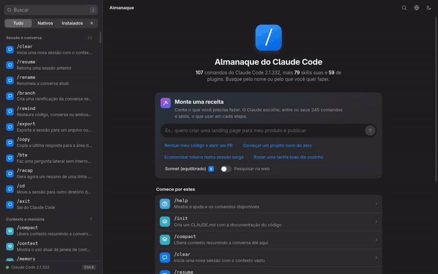
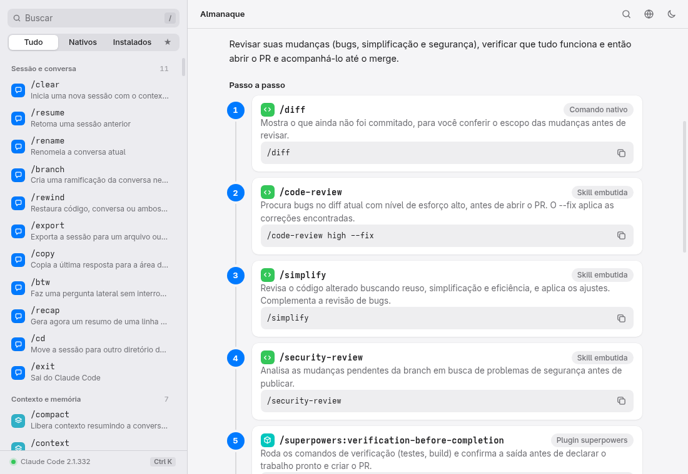

# Claude Code Almanac

[](https://www.npmjs.com/package/claude-code-almanac) [](https://github.com/GuilhermeBartmann/claude-code-almanac/actions/workflows/ci.yml) [](LICENSE)

**English** · [Português](README.pt-BR.md) · [Español](README.es.md)

A searchable guide to every Claude Code `/` command, in English, Portuguese and Spanish. It reads *your* installation (built-in commands, your skills, your plugins) and lets Claude build a step-by-step recipe from what you actually have.



## Run it

Requires Node.js 18+. No dependencies.

```bash
npx claude-code-almanac
# or
pnpm dlx claude-code-almanac
```

It opens in its own window, with no tabs or address bar, using the app mode of Chrome, Chromium, Edge or Brave (whichever you have; Edge ships with Windows). Without any of them, it opens a tab in your default browser. Closing the window quits the program.

To keep it installed:

```bash
npm i -g claude-code-almanac      # or: pnpm add -g claude-code-almanac
claude-code-almanac
```

On Linux, `claude-code-almanac --desktop` adds it to your app menu.

## What it does

- **Recipes.** Describe a need ("review my code and open a PR") and Claude picks, from the commands and skills installed on your machine, what to use at each step, with a ready-to-type example per step and a prompt you can paste into Claude Code to run the whole flow.
- **Every built-in command** with a plain-language explanation, syntax, examples and tips, in three languages.
- **New commands show up by themselves.** The almanac reads the installed Claude Code binary; if an update brings a command without a page yet, it appears under "New in this version" with its original description.
- **What you installed:** your skills (`~/.claude/skills`), custom commands (`~/.claude/commands`), the current project's (`.claude/`) and those from enabled plugins.
- **Live terminal preview** of each command, with the `/` autocomplete menu.
- **Quick search (Ctrl+K)** by name, alias or by what you want to do, plus favorites.
- **Ask Claude** about any command, right on its page.



## Asking Claude

Questions and recipes run the `claude` installed on your computer in non-interactive mode (`claude -p`), with the account you are already logged into, so they count toward your usage. The assistant gets no tools: it only explains, it never runs anything. Turn on "Search the web" to let it read the online docs.

## Options

```
claude-code-almanac [options]

  -p, --port <n>     Local port (default 4729)
  -b, --browser      Open in a browser tab instead of its own window
      --no-open      Only start the server, open nothing (runs until Ctrl+C)
      --desktop      Create an app menu shortcut (Linux)
  -v, --version      Show the version
  -h, --help         Show the help
```

## Privacy

Everything runs on your computer. The server only listens on `127.0.0.1` and requires a token generated on each run, so other pages open in your browser cannot use its API. Nothing leaves your machine except the questions you send to Claude.

## Contributing

The catalog lives in [`src/catalog.js`](src/catalog.js) (Portuguese, the source) with translations in [`src/i18n/`](src/i18n). To fix an explanation or add a page for a new command, edit those files and run:

```bash
npm test
```

It validates the catalog and translations, lists commands from your Claude Code version that still have no page, and starts the app once to check it works. CI runs the same test on Linux, macOS and Windows.

Community project, not affiliated with Anthropic.

## License

MIT
