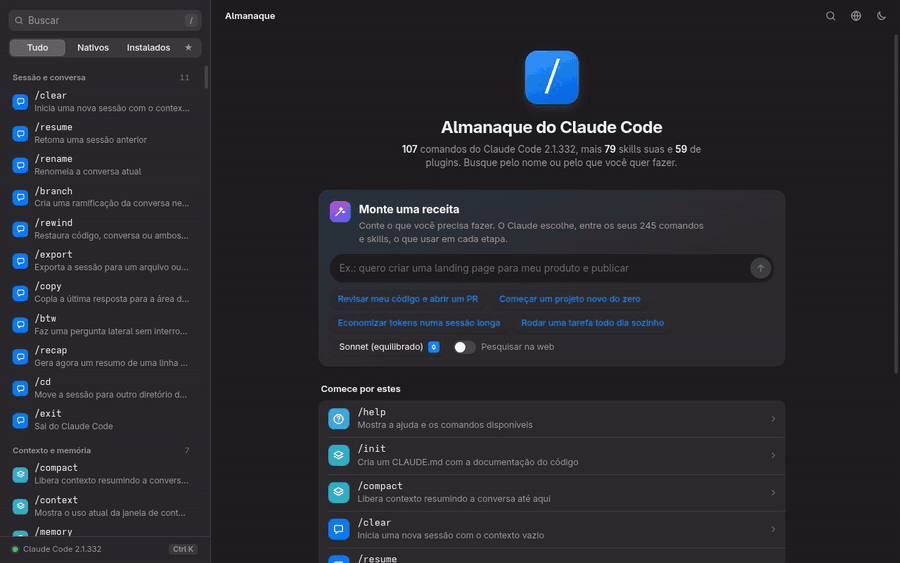
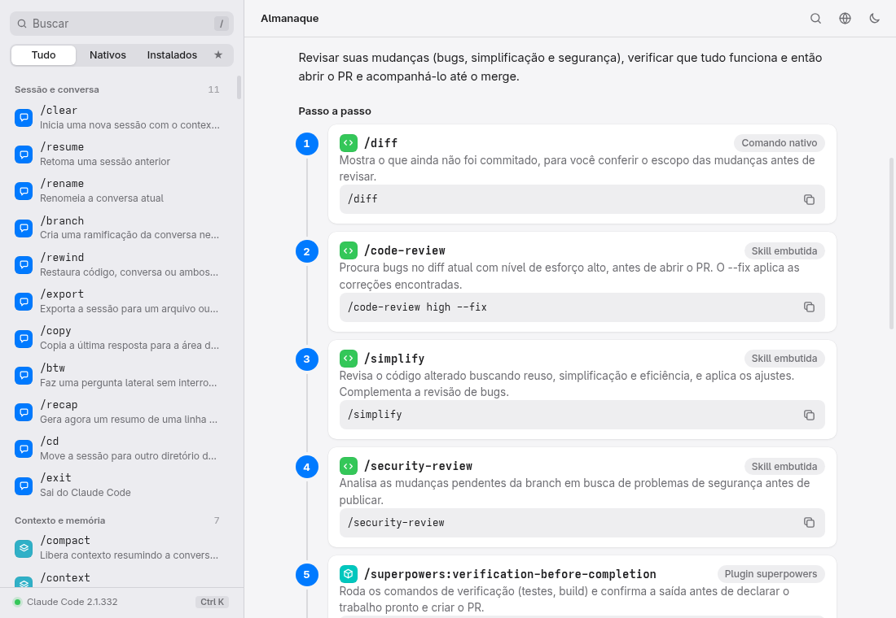

# Almanaque do Claude Code

[](https://www.npmjs.com/package/claude-code-almanac) [](https://github.com/GuilhermeBartmann/claude-code-almanac/actions/workflows/ci.yml) [](LICENSE)

[English](README.md) · **Português** · [Español](README.es.md)

Um guia pesquisável de todos os comandos `/` do Claude Code, em português, inglês e espanhol. Ele lê a *sua* instalação (comandos nativos, suas skills, seus plugins) e deixa o Claude montar uma receita passo a passo com o que você realmente tem.



## Rodar

Precisa de Node.js 18 ou mais novo. Não tem dependências.

```bash
npx claude-code-almanac
# ou
pnpm dlx claude-code-almanac
```

Abre numa janela própria, sem abas nem barra de endereço, usando o modo aplicativo do Chrome, Chromium, Edge ou Brave (o que você tiver; no Windows o Edge já vem instalado). Sem nenhum deles, abre numa aba do navegador padrão. Ao fechar a janela, o programa encerra sozinho.

Para deixar instalado:

```bash
npm i -g claude-code-almanac      # ou: pnpm add -g claude-code-almanac
claude-code-almanac
```

No Linux, `claude-code-almanac --desktop` cria um atalho no menu de aplicativos.

## O que ele faz

- **Receitas.** Descreva uma necessidade ("revisar meu código e abrir um PR") e o Claude escolhe, entre os comandos e skills instalados no seu computador, o que usar em cada etapa, com um exemplo pronto por passo e um prompt para colar no Claude Code e executar o fluxo inteiro.
- **Todos os comandos nativos** com explicação simples, sintaxe, exemplos e dicas, em três idiomas.
- **Comandos novos aparecem sozinhos.** O almanaque lê o binário do Claude Code instalado; se uma atualização trouxer um comando que ainda não tem ficha, ele aparece em "Novos nesta versão" com a descrição original.
- **O que você instalou:** suas skills (`~/.claude/skills`), comandos personalizados (`~/.claude/commands`), os do projeto atual (`.claude/`) e os dos plugins ativos.
- **Prévia no terminal** de cada comando, com o menu de autocompletar do `/`.
- **Busca rápida (Ctrl+K)** por nome, apelido ou pelo que você quer fazer, e favoritos.
- **Pergunte ao Claude** sobre qualquer comando, na própria ficha.



## Perguntar ao Claude

Perguntas e receitas rodam o `claude` instalado no seu computador em modo não interativo (`claude -p`), com a conta em que você já fez login. Isso conta no seu limite de uso. O assistente não recebe ferramentas: ele só explica, não executa nada. Ligue "Pesquisar na web" para deixá-lo consultar a documentação online.

## Opções

```
claude-code-almanac [opções]

  -p, --port <n>     Porta local (padrão 4729)
  -b, --browser      Abre numa aba do navegador, em vez de janela própria
      --no-open      Só sobe o servidor, sem abrir nada (fica rodando até Ctrl+C)
      --desktop      Cria um atalho no menu de aplicativos (Linux)
  -v, --version      Mostra a versão
  -h, --help         Mostra a ajuda
```

## Privacidade

Tudo roda no seu computador: o servidor escuta só em `127.0.0.1` e exige um token gerado a cada execução, então outras páginas abertas no navegador não conseguem usar a API. Nada sai da sua máquina, exceto as perguntas que você faz ao Claude.

## Contribuir

O catálogo fica em [`src/catalog.js`](src/catalog.js) (em português, a fonte), com as traduções em [`src/i18n/`](src/i18n). Para corrigir uma explicação ou dar ficha a um comando novo, edite esses arquivos e rode:

```bash
npm test
```

O teste valida o catálogo e as traduções, lista os comandos da sua versão do Claude Code que ainda não têm ficha e sobe o app uma vez para conferir que funciona. O CI roda o mesmo teste em Linux, macOS e Windows.

Projeto da comunidade, sem vínculo com a Anthropic.

## Licença

MIT
